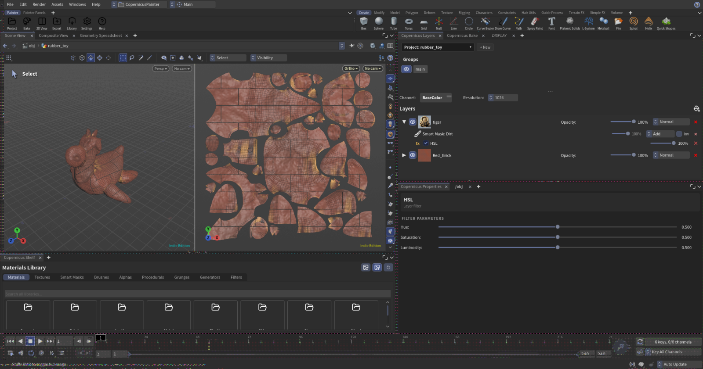
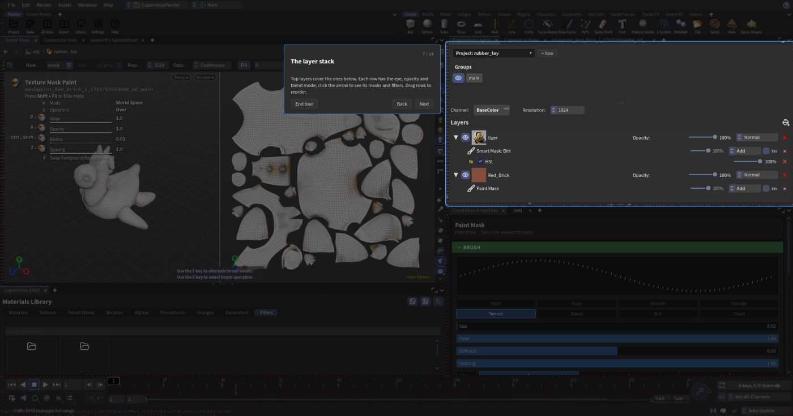

# Copernicus Painter

Texture painting inside Houdini, the way Substance 3D Painter works. You stack layers of materials, decide where each shows with masks, change them with filters and paint with brushes. It's all built on Copernicus, Houdini's GPU image network, so nothing leaves Houdini and everything stays procedural.

## What's in it

- **Layers** of procedural materials and texture sets, with opacity and blend modes per layer and per channel (BaseColor, Roughness, Metalness, Normal, Height, AO...).
- **Masks** that say where a layer shows: paint them, fill them, pick UV islands, or use generators that read the baked mesh maps (Dirt, Edge Wear, Curvature, Ambient Occlusion...). Grunges and procedural noises work as masks too.
- **Filters**:
    - mask filters (Blur, Levels, Histogram Scan, Warp...) on the mask stack;
    - layer filters (HSL, Color Balance, Gradient Map, Height to Normal...) on a layer's channels.
- **Brushes and alphas**: brush presets, stamps, a library of alpha shapes; paint in 3D or in the 2D (UV) view.
- **A 2D view** next to the 3D one: the model laid out flat by its UVs, painted at the same time.
- **Your own smart materials and smart masks**, made in Copernicus and saved to your library.
- **UDIMs**, texture set groups, baking, and export presets for engines and renderers.

## Start here

1. [Installation](installation.md)
2. [Your first project](workflow.md): project, bake, layers, export.
3. [Layers, masks and filters](layers.md)
4. [Painting](painting.md)
5. [The shelf and your libraries](library.md)
6. [Making smart materials](material_creator.md)

!!! tip "The guided tour"
    **Help** on the Painter shelf has two guided tours: one walks you through a first project step by step, highlighting each part of the screen as it goes; the other covers making your own smart material. Help also opens this documentation. The first tour starts by itself the first time you open the Painter desktop.

