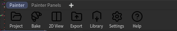

# Installation

## Requirements

- **Houdini 22.0** (tested on 22.0.459). Houdini 21 is not supported.
- Windows 10 or 11.
- The tool's assets were saved in Houdini Indie. A full commercial Houdini asks to switch the session to Limited Commercial when it loads them; Indie and Apprentice don't ask.

## Install

1. Close Houdini.
2. Unzip `CopernicusPainter_v<version>.zip` into your Houdini preferences folder, next to the `packages` folder (not inside it):
   ```
   C:\Users\<you>\Documents\houdini22.0\CopernicusPainter\
   ```
3. Copy `CopernicusPainter\CopernicusPainter.json` into that preferences folder's `packages` folder (create it if it isn't there):
   ```
   C:\Users\<you>\Documents\houdini22.0\packages\CopernicusPainter.json
   ```
4. Start Houdini.

To update, delete the old `CopernicusPainter` folder first, then do the steps above.

## First launch

Pick the **CopernicusPainter** desktop from Houdini's desktop menu (top of the window). It lays Houdini out like a painting app:

- the viewer, split into the 3D view and the 2D (UV) view;
- **Layers** and **Properties** on the right;
- the **shelf** of materials, brushes, masks and filters at the bottom;
- the **Painter** shelf at the top left.



| Button | What it does |
|---|---|
| **Project** | Create a project from a mesh, or resume one |
| **Bake** | Bake the mesh maps (curvature, occlusion, position...) |
| **2D View** | Split the viewer into 3D and 2D, or put the 2D view back on its framing |
| **Export** | Write the textures |
| **Library** | Make your own smart materials and smart masks |
| **Settings** | Your library folders |
| **Help** | The guided tours, and this documentation |

The first time, the guided tour starts by itself. Close it with **End tour**; it is under **Help** whenever you want it back. Then go on with [your first project](workflow.md).
