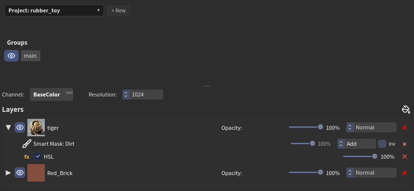
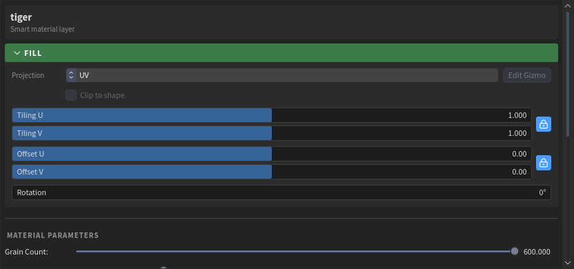
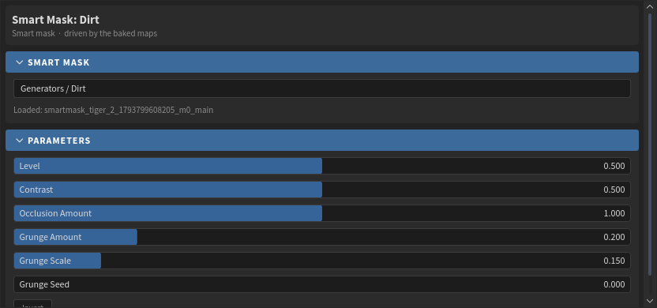
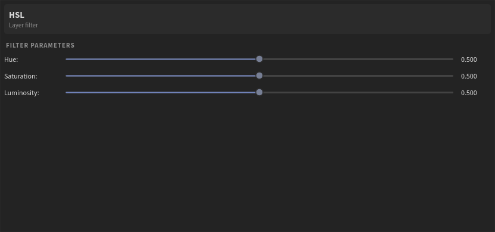
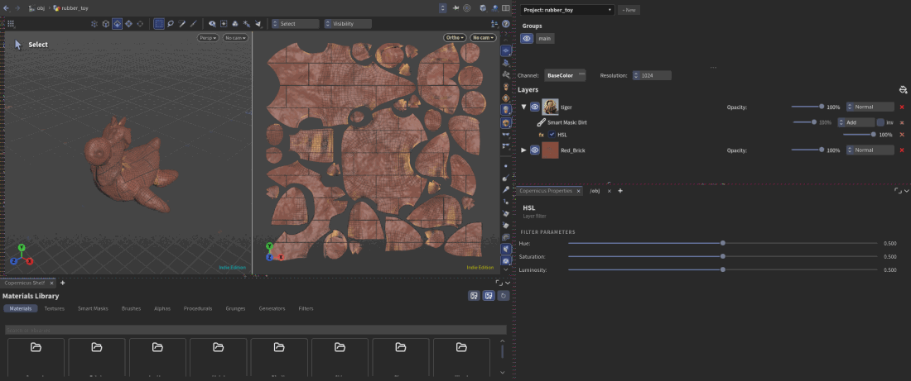

# Layers, masks and filters

## The layer stack

Layers stack like in Substance Painter: the top layer covers the ones below. Each row has:

- the **arrow**, which shows the layer's masks and filters;
- the **eye**, to hide it;
- its icon and name (double-click to rename);
- **Opacity** and the **blend mode** (Normal, Add, Subtract, Multiply, Screen, Overlay);
- **delete** (the red cross).

Drag rows to reorder them. Right-click a layer for **Duplicate Layer** and **Add Mask**.

At the top of the panel:

- **Groups**: the texture sets of the project. Each has its own stack; the eye hides it in the viewer.
- **Channel**: which channel the viewer shows (BaseColor, Roughness, Normal...).
- **Resolution**: the project's texture size.

## Properties

Click a layer, a mask or a filter: its controls show in **Properties**.

For a layer:

- **Fill**: how it's put on the model.
    - **Projection**: *UV*, or *Planar*, *Triplanar*, *Cylinder*, *Spherical* with a gizmo in the viewer (**Edit Gizmo**). **Clip to shape** limits it to the gizmo.
    - **Tiling**, **Offset** and **Rotation**. The lock keeps U and V together.
- **Material**: which channels the layer writes (click to turn one off) and their values.
- The material's own controls: colours, patterns, wear, grain... whatever its maker put on it.

## Masks

A mask says where its layer shows: **white shows the layer, black hides it**. Masks stack like layers. The first starts from black, each one goes on top with its own blend mode and opacity, and **inv** inverts one. Several masks add up the way their blend modes say.

Ways to add a mask:

- **From the shelf**: drag a **Generator**, a **Grunge** or a **Procedural** onto a layer.
- **Right-click the layer > Add Mask**:
    - **Paint Mask**: paint it ([Painting](painting.md)).
    - **Fill (White)**, **Fill (Black)**: the whole layer, or none of it, to paint into.
    - **Procedural Generators > Smart Mask / Grunge**: then pick one in Properties.
    - **Mesh Fill**: whole UV islands or connected pieces; **Select Islands** in Properties, click them in the viewer (3D or 2D), Enter when done.

### Generators

Generators make masks from the baked maps, like Substance Painter's: **Dirt**, **Edge Wear**, **Curvature**, **Ambient Occlusion**, **Cavity**, **Thickness**, **Light**, **Position Gradient**, **3D Linear Gradient**, **World Space Normals**, **UV Border Distance**, **Mask Builder** and more. They need the bake (see [Bake](workflow.md#3-bake-the-mesh-maps)). Each has its controls in Properties: amount, contrast, a grunge to break it up...

## Filters

Filters change what is below them. There are two kinds, on the **Filters** shelf:

- **Mask filters** (*Filters > Mask*): Blur, Directional Blur, Levels, Histogram Scan, Histogram Shift, Clamp, Invert, Contrast / Luminosity, Highpass, Sharpen, Warp, Slope Blur, Transform, Bevel, Mask Outline. Dropped on a layer, a mask filter goes on its mask stack and works on the masks **below it**.
- **Layer filters** (*Filters > Layer*): HSL, Color Correct, Color Balance, Gradient Map, Contrast / Luminosity, Invert, Levels, Blur, Sharpen, Height to Normal. They work on the layer's **channels** (its colour, roughness, height...).

Dropped on a layer, a layer filter shows under its masks as a **fx** row with on/off, opacity and delete. Several filters run in order, each on the result of the one before. Click the row for its controls.

## Undo

Every change here (a layer added, a mask's blend mode, a slider let go, a filter deleted) is one undo step.
