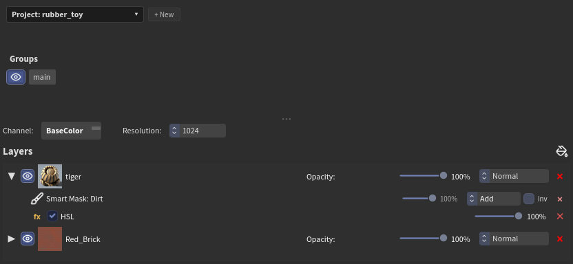
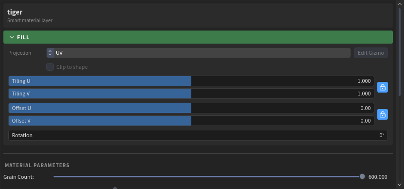
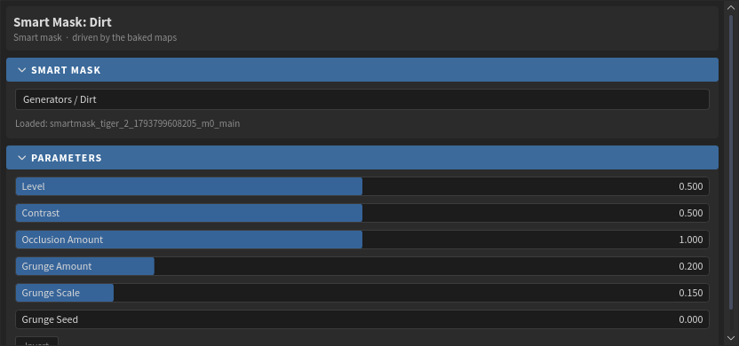
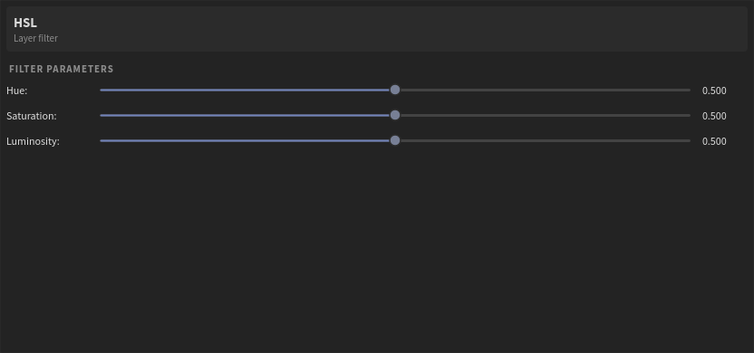
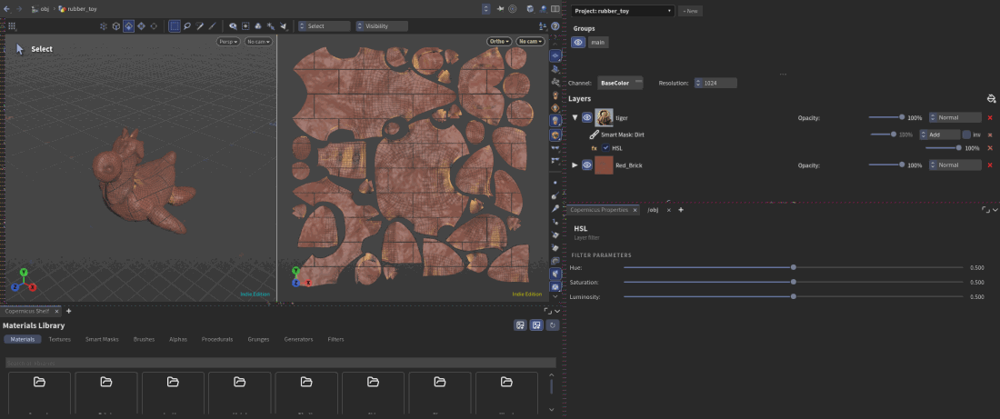

# Layers, masks and filters

## The layer stack

Layers stack like in Substance Painter: the top layer covers the ones below. Each row has:

- the **arrow**, which shows the layer's masks and filters;
- the **eye**, to hide it;
- its icon and name (double-click to rename);
- **Opacity** and the **blend mode** (Normal, Add, Subtract, Multiply, Screen, Overlay). The Normal channel's blend is different: **Offset** / **Signed** combine the layer's bumps with the ones below (Substance Painter's *Normal map Detail*), **Replace** hides the bumps below where the layer shows (Painter's *Normal*: smooth paint over a rough fabric);
- **delete** (the red cross).

Drag rows to reorder them. Right-click a layer for **Duplicate Layer**, **New Folder**, **Move into / out of Folder**, **Merge** / **Merge Down**, **Add Mask** and **Save as Smart Material…** (the layer or folder with all in it, to your library: see [Saving layers as a smart material](library.md#saving-layers-as-a-smart-material)).

A dropped material or a new fill layer is selected, so its settings are in Properties straight away. A new fill layer shows its colour (BaseColor) from the start.

### The toolbar

Above the stack, like Substance Painter's:

| Button | What it does |
|---|---|
| **Mask** | Add a mask to the selected layer (the same list as Add Mask) |
| **Generator** | Add a generator from your libraries (Dirt, Edge Wear...) as a mask |
| **Filter** | Add a filter from your libraries |
| **New Folder** | A folder above the selected layer (inside its folder, if it is in one) |
| **Duplicate**, **Delete** | On what is selected: a layer, a mask or a filter |

What is selected is highlighted in orange: a layer, or a mask or filter row. Duplicate and Delete act on exactly that (their tooltips say which).

At the top of the panel:

- **Groups**: the texture sets of the project. Each has its own stack; the eye hides it in the viewer.
- **Channel**: which channel's opacity and blend mode the layer rows show and edit (BaseColor, Roughness, Normal...).
- **Channels**: the [extra channels](#extra-channels) the project has (Emission, Transmission, Subsurface).
- **View**: what the 3D and 2D views show: **Material**, or one channel alone (BaseColor, Roughness, Metalness, Normal, Height...), flat and unlit, like Substance Painter's channel views. It is only a way of looking, not an edit (no undo step), and the project remembers it.
- **Resolution**: the project's texture size.
- **Height to Normal**: see [below](#height-to-normal).

## Properties

Click a layer, a mask or a filter: its controls show in **Properties**.

For a layer:

- **Fill**: how it's put on the model.
    - **Projection**: *UV*, or *Planar*, *Triplanar*, *Cylinder*, *Spherical* with a gizmo in the viewer (**Edit Gizmo**). **Clip to shape** limits it to the gizmo.
    - **Tiling**, **Offset** and **Rotation**. The lock keeps U and V together. On a smart material, Tiling and Offset scale and move its pattern (grain, noise, grunge), while what follows the model (edge wear, dirt in the cavities) stays where it is. Rotation applies to image materials only.
- **Material**: which channels the layer writes (click to turn one off) and their values. A colour's swatch (or its button) opens Houdini's colour editor.
- The material's own controls: colours, patterns, wear, grain... whatever its maker put on it.

## Extra channels

A project has the usual channels: BaseColor, Roughness, Metalness, Specular, Normal, Height, AO and Opacity. For glowing, see-through or translucent materials, add more with **Channels** (above the stack), like the channels of a Substance Painter texture set:

| Channel | For | Where it shows |
|---|---|---|
| **Emission** | Glow: screens, lamps, lava, runes (an RGB colour; black emits nothing) | 3D view, Render, export |
| **Transmission** | Glass, water, gems: light passing through | Render (Karma); roughly in the 3D view |
| **Subsurface** + **Subsurface Color** | Skin, wax, leaves, marble: light scattering inside | Render (Karma); roughly in the 3D view |

Tick one to add it, untick it to remove it (one undo step each). Each channel adds nodes to every layer, so add only the ones you use.

When you add a channel:

- every layer gets it, **off** (in Properties > Material, click its button to turn it on, then set its value or texture);
- a smart material layer whose material has an output for it (an **Emission** output, say) uses that output straight away;
- layers added after it fill it like the other channels: a texture folder's `_Emissive`, `_Transmission`, `_Subsurface` / `_SSS` maps, a smart material's *Emission*, *Transmission*, *Subsurface*, *Subsurface Color* outputs.

**View** shows a channel alone (View > Emission...), the **Render** view uses them (and Opacity, for cut-outs), and **Export** writes them: tick Emission, Transmission or Subsurface in the preset.

## Masks

A mask says where its layer shows: **white shows the layer, black hides it**. Masks stack like layers. The first starts from black, each one goes on top with its own blend mode and opacity, and **inv** inverts one. Several masks add up the way their blend modes say.

Each mask has an **eye**: off, that mask adds nothing (its opacity is kept for when you turn it on again). Filters have the same eye.

Ways to add a mask:

- **From the shelf**: drag a **Generator**, a **Grunge** or a **Procedural** onto a layer.
- **Right-click the layer > Add Mask**:
    - **Paint Mask**: paint it ([Painting](painting.md)).
    - **Fill (White)**, **Fill (Black)**: the whole layer, or none of it, to paint into.
    - **Procedural Generators > Smart Mask / Grunge**: then pick one in Properties.
    - **3D Path**: paths drawn on the model, as lines or ribbons of text or images ([3D Path](path.md)).
    - **Mesh Fill**: whole UV islands or connected pieces; **Select Islands** in Properties, click them in the viewer (3D or 2D), Enter when done. The mask stays on the islands you pick: it doesn't bleed into islands next to them in UV.

### Generators

Generators make masks from the baked maps, like Substance Painter's: **Dirt**, **Edge Wear**, **Curvature**, **Ambient Occlusion**, **Cavity**, **Thickness**, **Light**, **Position Gradient**, **3D Linear Gradient**, **World Space Normals**, **UV Border Distance**, **Mask Builder** and more. They need the bake (see [Bake](workflow.md#3-bake-the-mesh-maps)). Each has its controls in Properties: amount, contrast, a grunge to break it up...

## Filters

Filters change what is below them. There are two kinds, on the **Filters** shelf:

- **Mask filters** (*Filters > Mask*): Blur, Directional Blur, Levels, Histogram Scan, Histogram Shift, Clamp, Invert, Contrast / Luminosity, Highpass, Sharpen, Warp, Slope Blur, Transform, Bevel, Mask Outline. Dropped on a layer, a mask filter goes on its mask stack and works on the masks **below it**.
- **Layer filters** (*Filters > Layer*): HSL, Color Correct, Color Balance, Gradient Map, Contrast / Luminosity, Invert, Levels, Blur, Sharpen, Height to Normal. They work on the layer's **channels** (its colour, roughness, height...).

Dropped on a layer, a layer filter shows under its masks as a **fx** row with on/off, opacity and delete. Several filters run in order, each on the result of the one before. Click the row for its controls.

## Moving and copying masks and filters

Like Substance Painter's effects:

- **Drag** a mask or a filter row up or down to change its place in its layer.
- **Drag** it onto another layer to move it there; hold **Ctrl** while you drop to **copy** it instead.
- **Right-click** a mask or filter: **Copy**, **Duplicate**, **Paste**, **Delete**. Right-click a layer to **Paste** a copied mask or filter on it.

A copy is complete: a paint mask keeps its strokes, a generator or filter its settings.

## Folders

Folders group layers, like Substance Painter's.

- **New Folder** (toolbar, or right-click a layer) adds an empty folder above the selected layer, in the same folder: with a layer in a folder selected, you get a folder inside that folder.
- To put a layer (or a folder) in: drop it **on the folder's row**, or **below the open folder** among its layers. Right-click for **Move into Folder** / **Move out of Folder** (out goes one level up). A material dropped into an open folder lands in it.
- **Folders go inside folders**, as deep as you like; each level is indented a step more. A folder never goes inside itself or one of its own folders.
- A folder's **opacity**, **eye**, **masks** and **filters** act on everything in it together: its layers are blended as usual, its filters work on that result (a Blur or HSL on the whole group), then the folder mixes it over what is below.
- Moving, duplicating, merging or deleting a folder takes everything in it along. Undo brings it all back.

## Merge and Merge Down

Right-click:

- a **folder > Merge**: the folder and its layers become one layer;
- a **layer > Merge Down**: it and the layer right below it (in the same folder) become one layer.

The merged layer looks exactly the same: masks, opacities and blends are baked into it. It is kept in the hip file (no image files to carry around) and is fast to work with. Its settings are gone: to change it, add masks, filters or layers above it. Undo brings the original layers back.

Layers blended **Normal** merge exactly; Multiply, Screen and Overlay layers merge closely but not exactly.

## Decals

A decal is an image laid on the model, like a sticker: a logo, a label, a graphic.

- **Decal** on the toolbar picks an image and lays it in the middle of the 3D view; or **drop an image file** (from Explorer) **onto the 3D view** and it lands where you drop it.
- The image is the layer's colour; its **alpha** cuts its shape out (an image without alpha shows whole). It is a **Planar** projection, clipped to its shape: **Edit Gizmo** moves, rotates and scales it.
- **Warp** (any Planar layer): **Edit Warp** shows a grid on the gizmo in the viewport: drag its points to bend the image onto the surface. **Split H**, **Split V** and **Split X** (or H, V, X in the viewport) add a row, a column or both; **Reset** (R) flattens it again.
- Like any layer it takes masks, filters, opacity; turn on its other channels (Height, Roughness...) in Properties for a raised or glossy decal.

## Height to Normal

**Height to Normal** at the top of the Layers panel puts the stack's height in its normal map, as Substance Painter does: whatever raises Height (stitches, stamps, a decal or a painted bump, a material's own height) shows in the normals too, in the viewport and in the export. 0 turns it off. New projects start at 0.5; projects made before it was added start at 0, so they look as they did.

## Undo

Every change here (a layer added, a mask's blend mode, a slider let go, a filter deleted) is one undo step.
