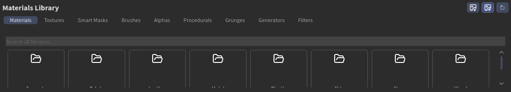
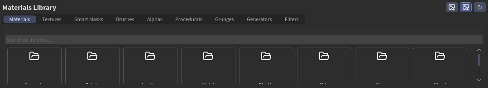
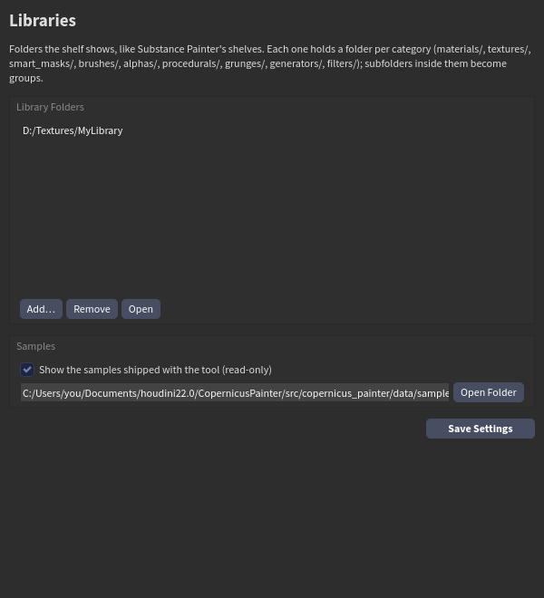

# The shelf and your libraries

The shelf at the bottom of the Painter desktop shows your libraries, like Substance Painter's shelves. It shows the samples that come with the tool, plus any library folders you add.



## The shelf tabs

| Tab | What is in it | How you use it |
|---|---|---|
| **Materials** | Procedural materials with controls (Skin, Fabric, Leather, Metal, Wood, Stone, Concrete, Plastic) | Drag onto Layers: a new layer |
| **Textures** | Image texture sets (BaseColor, Roughness, Normal... files) | Drag onto Layers |
| **Smart Masks** | Your saved masks | Drag onto a layer: a mask |
| **Brushes** | Brush presets | Click: paint with it; or drag onto a layer |
| **Alphas** | Brush tips (greyscale images) | Click: the brush tip |
| **Procedurals** | Noises and patterns, one mask each | Drag onto a layer: a mask |
| **Grunges** | Wear and dirt maps | Drag onto a layer: a mask |
| **Generators** | Masks from the baked maps (Dirt, Edge Wear...) | Drag onto a layer: a mask |
| **Filters** | Mask filters and layer filters | Drag onto a layer |

- **Groups** are folders: click one to go in, **< Back** to go out.
- **Search** looks in every library and every group.
- The buttons on the right switch the icon size and **refresh** the shelf after you add files on disk.



## Your own library

**Settings** on the Painter shelf lists your library folders.



- **Add...** picks a folder. A new, empty folder gets the category folders made for you.
- **Remove** takes one off the list (nothing is deleted), and **Open** shows it in Explorer.
- **Show the samples** turns the samples (read-only) on or off.
- **Save Settings** keeps it.

A library folder has one folder per tab:

```
MyLibrary/
├── materials/        procedural materials: a folder X with X.cpio (+ X.jpg icon)
├── textures/         texture sets: a folder of images (+ shader.jpg icon)
├── smart_masks/      X.cpio
├── brushes/          X.json brush presets (+ X.png)
├── alphas/           greyscale images
├── procedurals/      X.cpio
├── grunges/          X.cpio, or an image
├── generators/       X.cpio
└── filters/          X.cpio
```

Inside each, any folder that isn't an item is a **group**, at any depth (`materials/Metal/Rust/...`). The thumbnail sits next to the item: `<name>.jpg` or `.png`, `shader.jpg` for a texture set, and an alpha is its own.

**Texture sets** are read by their file names: `basecolor`/`albedo`/`diffuse`, `roughness`, `metal`, `normal`, `height`/`displacement`, `ao`/`occlusion`, `opacity`... A folder of textures downloaded from Poly Haven or similar works as it is.

Materials and masks you make yourself are saved here by the Library window: see [Making smart materials](material_creator.md).
