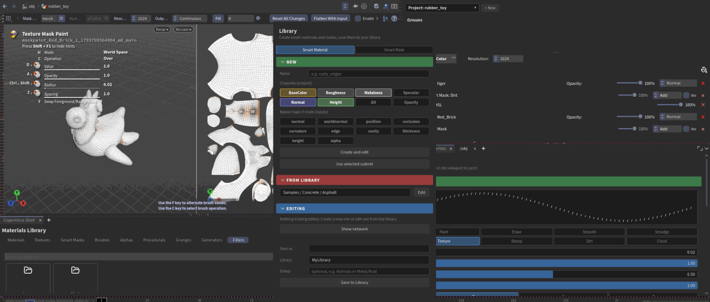
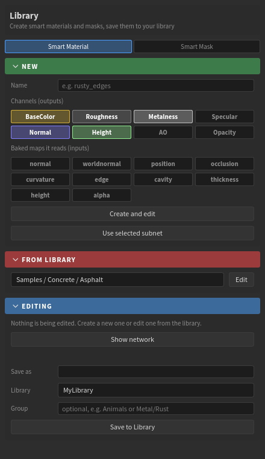
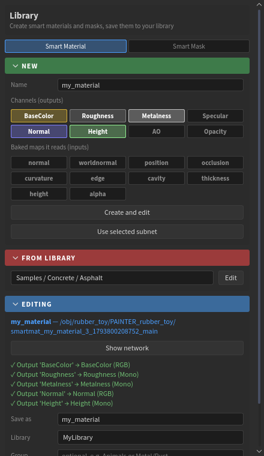

# Making smart materials

A smart material is a Copernicus **subnet**:

- **inside**, any COP network: noises, patterns, ramps, filters;
- **outputs** named after the channels it makes (BaseColor, Roughness, Metalness, Normal, Height...);
- **inputs** named after the baked maps it reads (Curvature, Occlusion, Position...);
- **controls** on the subnet, which show in Properties when its layer is selected.

A **smart mask** is the same with one output, **Mask**. Both are made in the **Library** window and saved to your library. **Help > Make your own smart material** is a step-by-step tour of it.

## 1. Open the Library window

Click **Library** on the Painter shelf.

At the top, pick **Smart Material** or **Smart Mask**.

## 2. New

- **Name** it.
- Pick its **Channels (outputs)**: BaseColor, Roughness, Metalness, Normal, Height, Specular, AO, Opacity.
- Pick the **Baked maps it reads (inputs)**: normal, worldnormal, position, occlusion, curvature, edge, cavity, thickness, height, alpha.
- Click **Create and edit**.

You get a layer with a ready subnet: every output is there, typed and named, fed by a constant, and every input is wired to its bake. The network editor opens inside it.

A smart mask goes on the selected layer instead (**Create on selected layer**).

Already built a subnet yourself? Select it in the network editor and click **Use selected subnet**.

## 3. Build inside

Replace the constants with your network. The layer updates while you work, so you see the material on the model as you build it.

## 4. Controls

Add the parameters you want to change later to the **subnet itself**: right-click it > **Edit Parameter Interface**. Use them inside with `ch("../name")`.

They show in Properties when the layer is selected:

- sliders, toggles and menus;
- colours, as colour fields;
- ramps, with their point editor;
- folders, as collapsible sections.

## 5. Check and save

**Editing** shows what the Painter makes of your subnet, so fix anything it marks before saving:

- which output feeds which channel;
- which input gets which bake;
- warnings, such as a bake not done yet or a name it doesn't know.

Then fill in:

- **Save as**: its name on the shelf.
- **Library**: one of your library folders (Settings); the samples are read-only.
- **Group**: optional, e.g. `Metal/Rust`.

Click **Save to Library**. It is saved with a rendered icon, and appears on the **Materials** shelf (smart masks on **Smart Masks**).

**From library > Edit** opens a saved one again as a new layer (for a mask, **Add to selected layer**).

## Names the Painter reads

| Output | Channel | Type |
|---|---|---|
| `BaseColor` | Base colour | RGB |
| `Roughness` | Roughness | Mono |
| `Metalness` | Metalness | Mono |
| `Normal` | Normal (tangent space, 0-1) | RGB |
| `Height` | Height | Mono |
| `Specular`, `AO`, `Opacity` | Specular, ambient occlusion, opacity | Mono |
| `Mask` | the mask (smart masks only) | Mono |

| Input | Baked map |
|---|---|
| `Normal`, `WorldNormal`, `Position` | Normals (tangent / world) and position (RGB) |
| `Occlusion`, `Curvature`, `Edge`, `Cavity`, `Thickness`, `Height`, `Alpha` | Mono maps |

Names are CamelCase and matched ignoring case. A smart mask with an input named **`Mask`** is a **mask filter**: it gets the masks below it.

!!! tip "Normal strength"
    Copernicus' Height to Normal strength works per UV unit, so a fine pattern gets very strong normals quickly. The samples are set so their normal map is about 95% flat on average. If a material looks all bumps, lower its normal strength.
