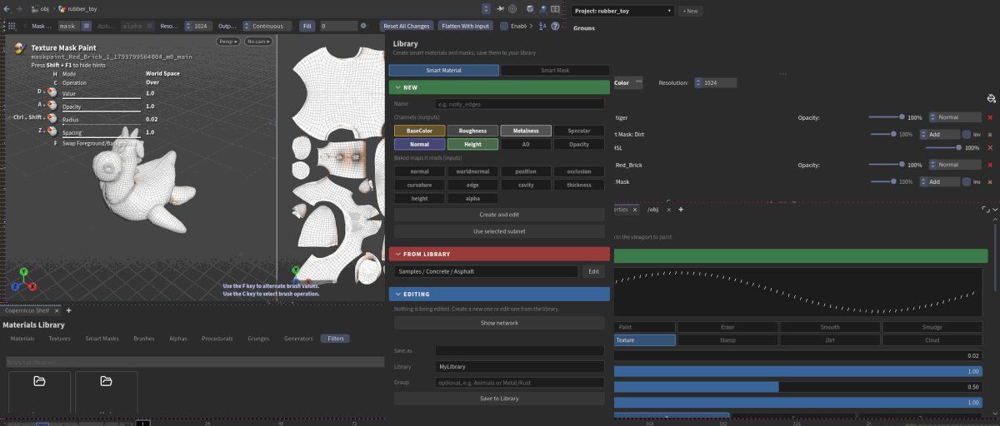
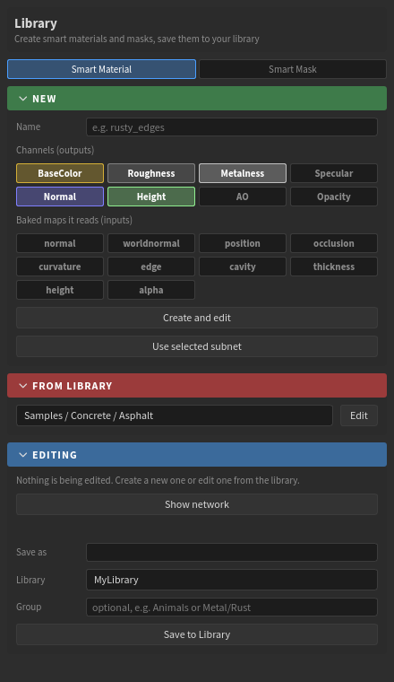
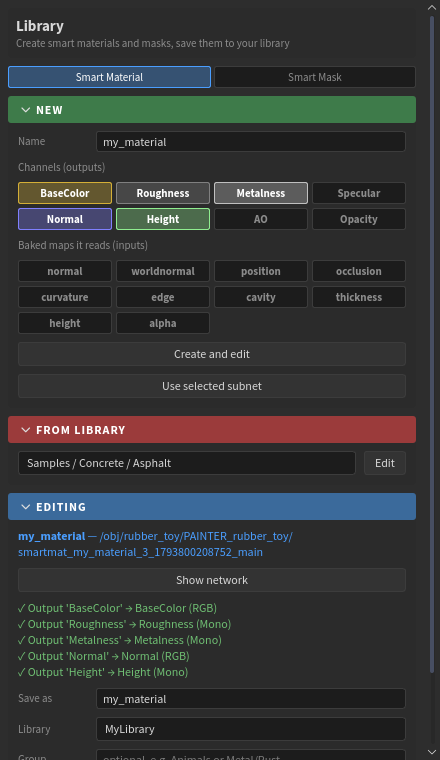

# Making smart materials

A smart material is a Copernicus **subnet**:

- **inside**, any COP network: noises, patterns, ramps, filters;
- **outputs** named after the channels it makes (BaseColor, Roughness, Metalness, Normal, Height...);
- **inputs** named after the baked maps it reads (Curvature, Occlusion, Position...);
- **controls** on the subnet, which show in Properties when its layer is selected.

A **smart mask** is the same with one output, **Mask**. Generators, procedurals, grunges, mask filters and layer filters are subnets too, with their own inputs and outputs. All of them are made in the **Library** window and saved to your library. **Help > Make your own smart material** is a step-by-step tour of it.

## 1. Open the Library window

Click **Library** on the Painter shelf.

At the top, **New** (make one) or **Edit** (change one of your library), then **What is it?**:

| Kind | What it needs | Where it goes while you build | Saved to |
|---|---|---|---|
| **Smart Material** | outputs named after the channels it makes; inputs named after the bakes it reads | a new layer | `materials/` |
| **Smart Mask** | one mono output, `Mask` | the selected layer's masks | `smart_masks/` |
| **Generator** | `Mask` out, made from bakes (`Curvature`, `Occlusion`...) | the selected layer's masks | `generators/` |
| **Procedural** | `Mask` out, a noise or a pattern, no inputs needed | the selected layer's masks | `procedurals/` |
| **Grunge** | `Mask` out, wear or dirt as a pattern | the selected layer's masks | `grunges/` |
| **Mask Filter** | a `Mask` input (the masks below it) and a `Mask` output | the selected layer's masks | `filters/` |
| **Layer Filter** | per channel it changes, an input and an output of that name (`BaseColor` in, `BaseColor` out) | the selected layer's filters | `filters/` |

The window shows what the kind needs right under it.

## 2. New

- **Name** it.
- Pick its **Channels**: for a smart material its outputs, for a layer filter the channels it changes.
- Pick the **Baked maps it reads (inputs)**: normal, worldnormal, position, occlusion, curvature, edge, cavity, thickness, height, alpha.
- Click **Create** (**on a new layer** for a smart material, **on the selected layer** for the rest).

You get a ready subnet that already meets the kind's needs: every output is there, typed and named, every input wired. A smart material's outputs start as constants; a filter's pass what comes in straight out, so it changes nothing until you build inside it. The network editor opens inside it.

Already built a subnet yourself? Select it in the network editor and click **Use selected subnet**.

## 3. Build inside

Replace the constants with your network. The layer updates while you work, so you see the material on the model as you build it.

## 4. Controls

Add the parameters you want to change later to the **subnet itself**: right-click it > **Edit Parameter Interface**. Use them inside with `ch("../name")`.

They show in Properties when the layer is selected:

- sliders, toggles and menus;
- colours, as colour fields;
- ramps, with their point editor;
- folders, as collapsible sections.

## 5. Check and save

**Editing** shows what the Painter makes of your subnet, so fix anything it marks before saving:

- which output feeds which channel;
- which input gets which bake;
- warnings, such as a bake not done yet or a name it doesn't know.

Then fill in:

- **Save as**: its name on the shelf.
- **Library**: one of your library folders (Settings); the samples are read-only.
- **Group**: optional, e.g. `Metal/Rust`.

Click **Save to Library**. It goes into the folder of its kind (see the table above), with an icon: a rendered ball for a smart material, the mask it makes for the others. It appears on the shelf tab of its kind.

**Edit** opens one of your library's again: pick it and click **Edit** (on a new layer for a smart material, on the selected layer for the rest). Saving a sample makes a copy in your library; your own saves back where it was.

## Names the Painter reads

| Output | Channel | Type |
|---|---|---|
| `BaseColor` | Base colour | RGB |
| `Roughness` | Roughness | Mono |
| `Metalness` | Metalness | Mono |
| `Normal` | Normal (tangent space, 0-1) | RGB |
| `Height` | Height | Mono |
| `Specular`, `AO`, `Opacity` | Specular, ambient occlusion, opacity | Mono |
| `Mask` | the mask (smart masks only) | Mono |

| Input | Baked map |
|---|---|
| `Normal`, `WorldNormal`, `Position` | Normals (tangent / world) and position (RGB) |
| `Occlusion`, `Curvature`, `Edge`, `Cavity`, `Thickness`, `Height`, `Alpha` | Mono maps |

Names are CamelCase and matched ignoring case. A smart mask with an input named **`Mask`** is a **mask filter**: it gets the masks below it.

!!! tip "Normal strength"
    Copernicus' Height to Normal strength works per UV unit, so a fine pattern gets very strong normals quickly. The samples are set so their normal map is about 95% flat on average. If a material looks all bumps, lower its normal strength.

## Generators, procedurals, grunges, filters and alphas

Pick the kind in the Library window (see the table at the top): it makes the right template, checks it, and saves it into the right folder. **Use selected subnet** checks and saves a subnet you built anywhere, as the kind you picked.

A **grunge** can also be just an image file in `grunges/`, and an **alpha** is an image file in `alphas/` (white paints, black doesn't): no subnet needed, drop the file in the folder.

**Help > Example: making assets** opens a network with one sample of each kind, each with a note on how it's built.
