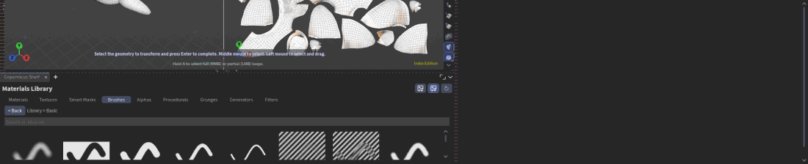
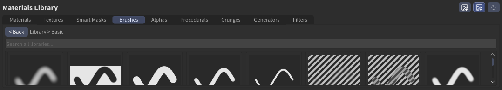
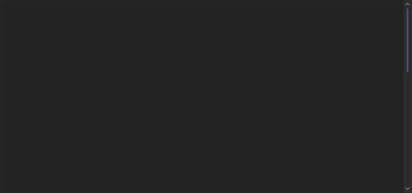

# Painting

You paint masks: where a layer shows. Paint white to show the layer, erase or paint black to hide it. The stroke lands on the model in the 3D view and on its flat copy in the 2D view at the same time, so paint in whichever is easier.

## Pick a brush

Open **Brushes** on the shelf and click one. If the selected layer has no paint mask, one is added, and you are painting with that brush straight away. You can also drag a brush onto any layer.

| Group | Brushes |
|---|---|
| **Basic** | Hard, Soft, Airbrush, Pencil, Marker, Eraser, Soft Eraser, Smooth, Smudge |
| **Texture** | Chalk, Bristle, Spray, Splatter, Sponge, Grunge, Rust, Scratches, Dirt, Cloud |
| **Stamps** | Rivet, Bolt, Screw, Stitches, Bullet Hole, Cracks, Drops |

The brush is one for the whole project, as in Substance Painter. Change it, and every paint mask paints with it.

**Alphas** on the shelf are brush tips: click one and the brush paints with it. There are 32 in four groups (**Shapes**, **Brush Tips**, **Grunge**, **Stamps**); add your own greyscale images to your library's `alphas` folder.

## Brush settings

Select the paint mask: Properties shows the brush.

- **Brush**: the stroke preview, the brush type (Paint, Erase, Smooth, Smudge, Texture, Stamp, Dirt, Cloud), **Size**, **Flow**, **Softness** and **Spacing**. **Mirror** paints on both sides of an axis.
- **Alpha**: the brush tip. Click the slot to pick an image, drop one on it, or click one in the list below. **Rotation** and **Scale** turn and size it.
- **Fill**: fill the whole mask black, white, or with a value.

## In the viewer

With the paint mask selected, the viewer is in the paint tool. Press **Tab** in the viewport if it isn't. Paint with the left mouse button; Houdini's paint keys work (for example **F** to change values, **C** for the brush operation, **Shift+F1** for the hints).

Each stroke is an undo step.

!!! note "Painting colour"
    You paint masks today, so a layer shows its material where you paint. To paint a colour, use a layer with that colour (a material with its colour set) and paint its mask.
