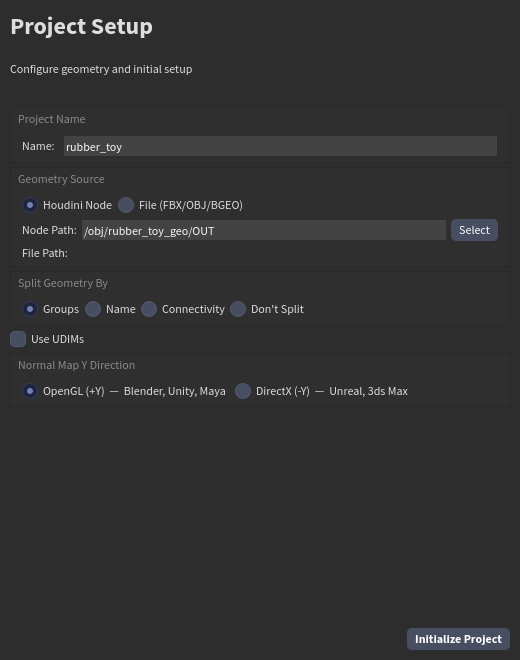
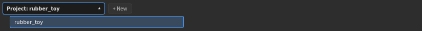
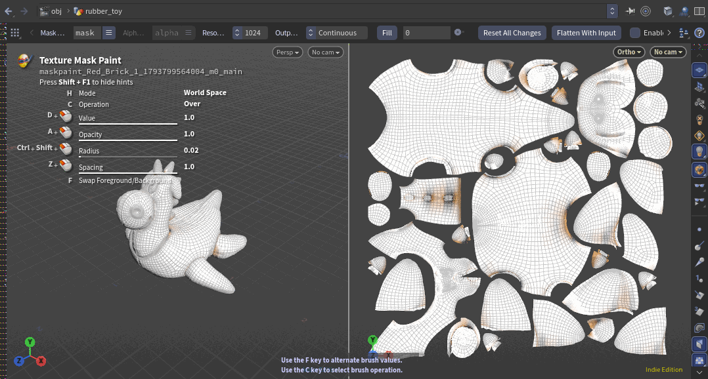
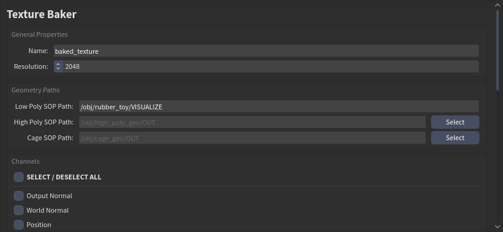
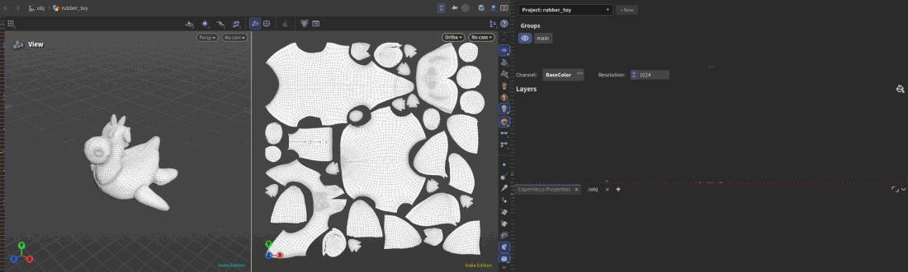
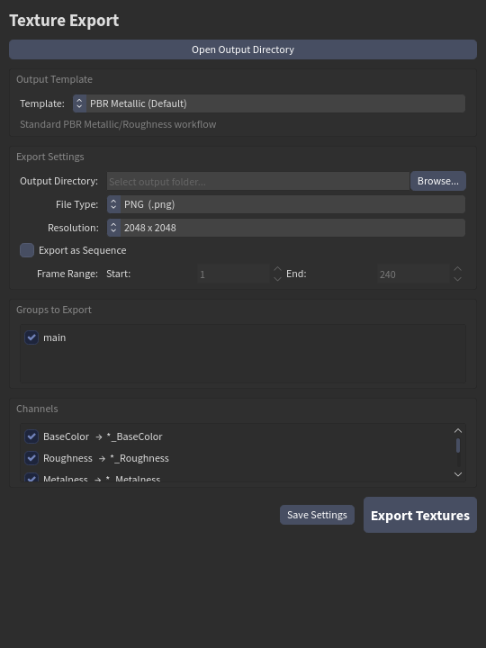

# Your first project

The whole loop: a project, the baked maps, a few layers, export. Each part has its own page for the details.

## 1. Create a project

A project is one node in `/obj` that holds the whole texture set: the layer stack, the masks, the bakes. Click **Project** on the Painter shelf (or **New…** at the top of the Layers panel).

| Field | What it is |
|---|---|
| **Project Name** | The name of the project node |
| **Geometry Source** | A Houdini node (its path, or **Select**) or a file (FBX, OBJ, BGEO) |
| **Split Geometry By** | How the mesh is cut into texture sets: by *Groups*, *Name*, *Connectivity*, or *Don't Split* |
| **Use UDIMs** | One texture per UV tile (1001, 1002...) |
| **Normal Map Y Direction** | *OpenGL (+Y)*: Blender, Unity, Maya, Houdini. *DirectX (-Y)*: Unreal, 3ds Max |

The mesh needs **UVs** and **normals**. Click **Initialize Project**.

Each texture set (a group from the split) has its own layer stack. Pick it in **Groups** at the top of the Layers panel; the eye hides it in the viewer.

### Several projects in one hip

A hip can hold several projects. **Project** at the very top of the Layers panel says which one you are on: click it to list them all and pick another. Opening a hip opens the project you used last in it.

## 2. The 3D and 2D views

The viewer is split. On the left is your model; on the right, the **2D view**: the same model laid out flat by its UVs, like Substance Painter's 2D view. Everything shows in both, and you can paint in both.

In the 2D view you **pan** and **zoom** as in any Houdini view (hold **Space** and drag with the middle mouse to pan; the wheel zooms towards the pointer). It never rotates, and moving it is not an edit, so it adds nothing to undo. **2D View** on the shelf puts it back on its home framing.

## 3. Bake the mesh maps

Click **Bake**. The baked maps are what generators and smart materials read: curvature for edge wear, occlusion for dirt in the cavities, position for gradients.

Pick the resolution, the low-poly mesh (your project's), optionally a high-poly and a cage, tick the maps and click **Bake Textures**. Bake at least **Position** and **World Normal**, which the projections need. **Preview Baked Channel** shows a map on the model.

## 4. Layers

The shelf at the bottom is your library. Drag a material onto the **Layers** panel. **Materials** are procedural, with controls; **Textures** are image sets. Drop more, then add masks and filters to them.

The GIF shows a red brick, then a tiger skin over it, a **Dirt** mask so the tiger only shows in the cavities, and an **HSL** filter on the tiger. All of that is on [Layers, masks and filters](layers.md).

## 5. Paint

Click a brush on the **Brushes** shelf: the layer gets a paint mask and you are painting. See [Painting](painting.md).

## 6. Export

Click **Export**.

| Setting | What it is |
|---|---|
| **Template** | Which maps and how they are named and packed: *PBR Metallic*, *Unreal Engine 5* (packed ORM), *Unity URP/HDRP*, *Houdini / Mantra* |
| **Output Directory** | Where the files go (**Open Output Directory** opens it) |
| **File Type** | PNG, JPEG, EXR or TIFF |
| **Resolution** | The exported size |
| **Merge groups by UDIM tile** | On UDIM projects: one file per tile with every texture set in it |
| **Export as Sequence** | Frames from *Start* to *End*, for animated layers |

**Export Textures** writes them; **Save Settings** keeps the choice with the project.

## Undo

Everything you do in the panels is one undo step: **Ctrl+Z**, **Ctrl+Shift+Z**, and the panels follow. Moving the views isn't an edit.
